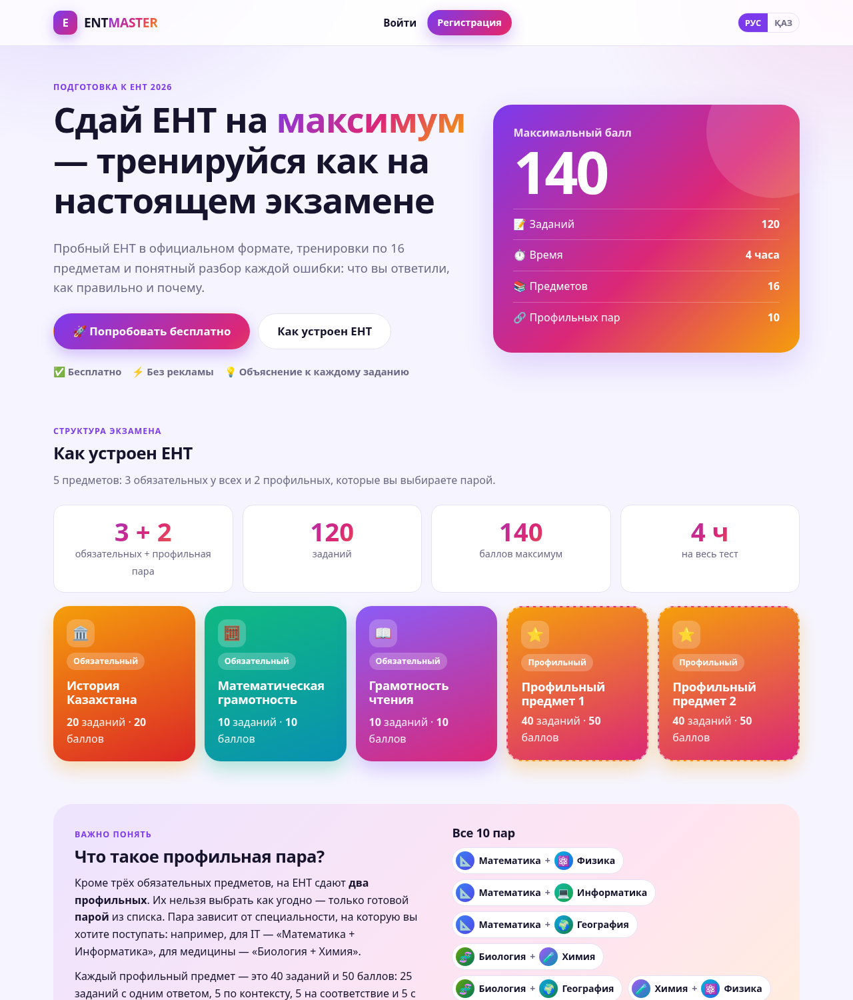
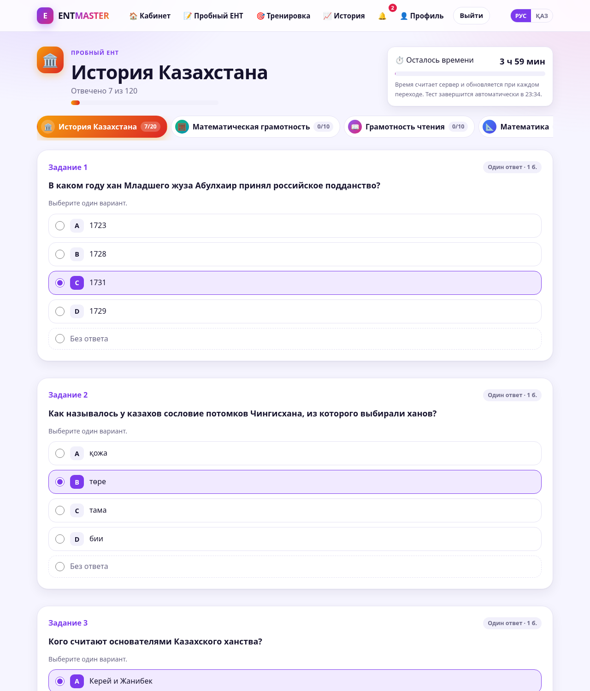
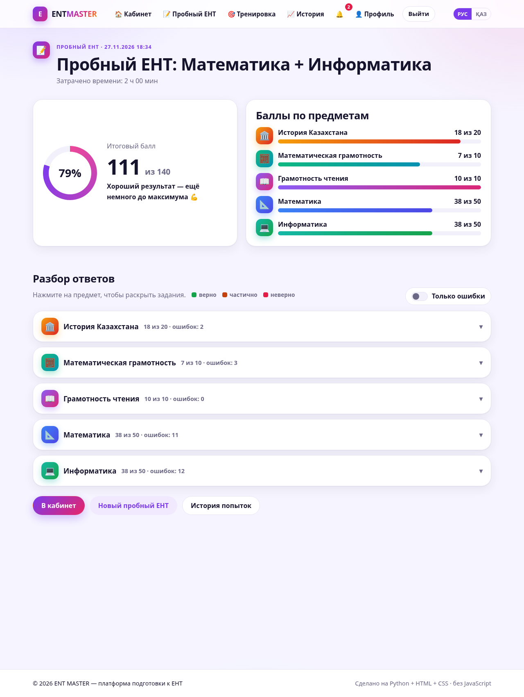
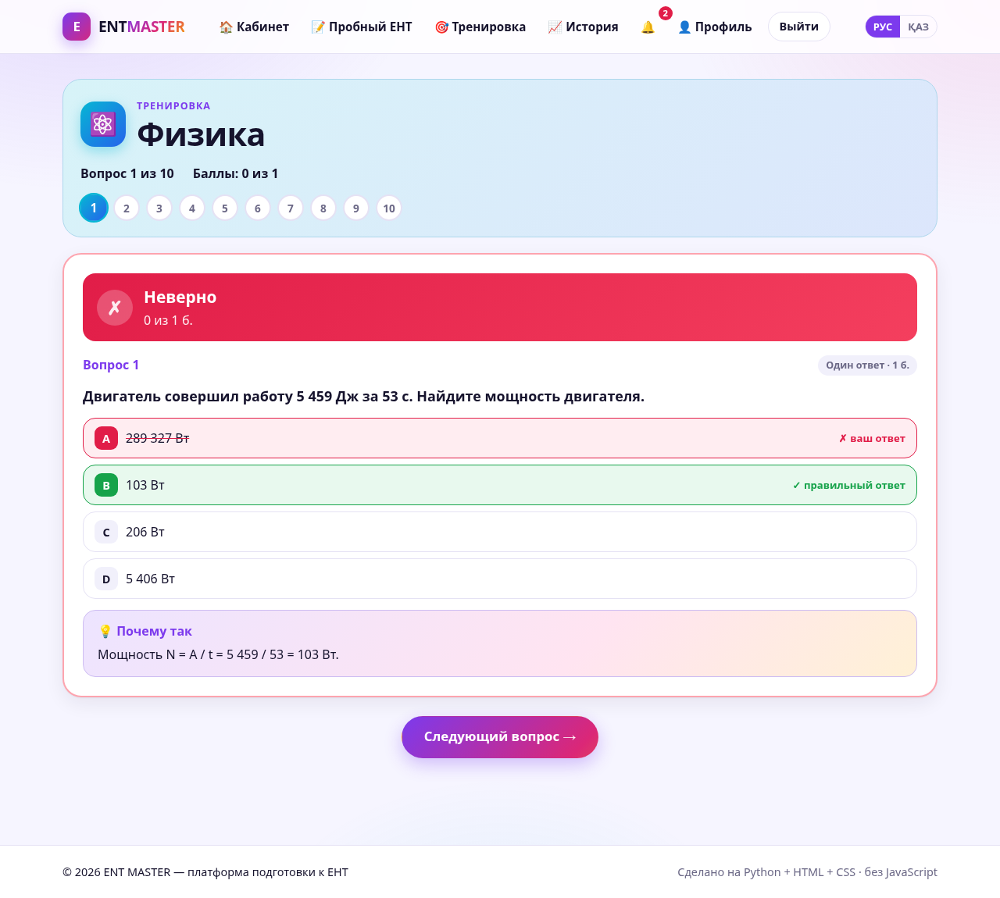
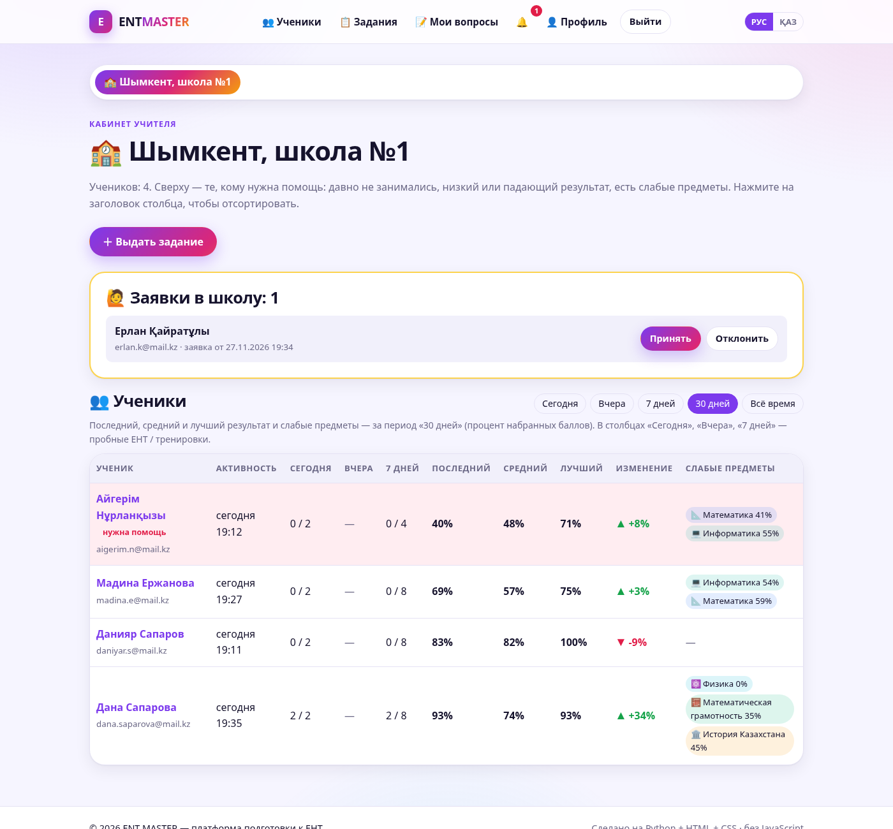
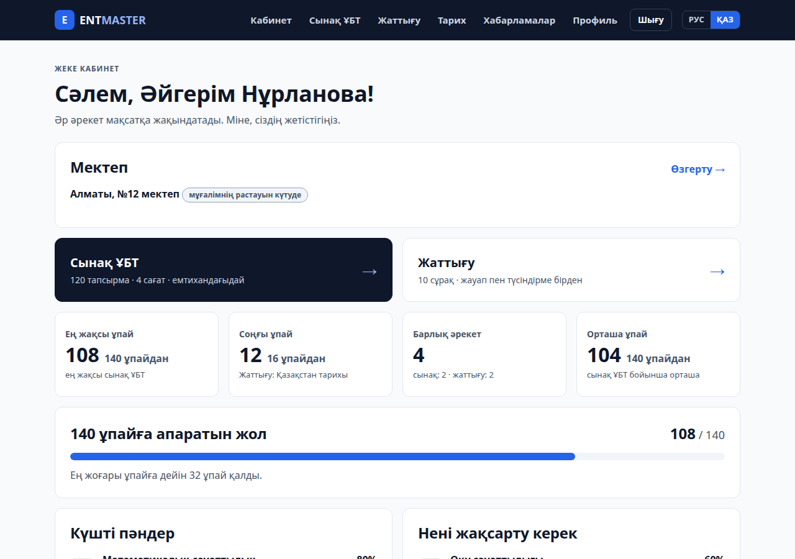
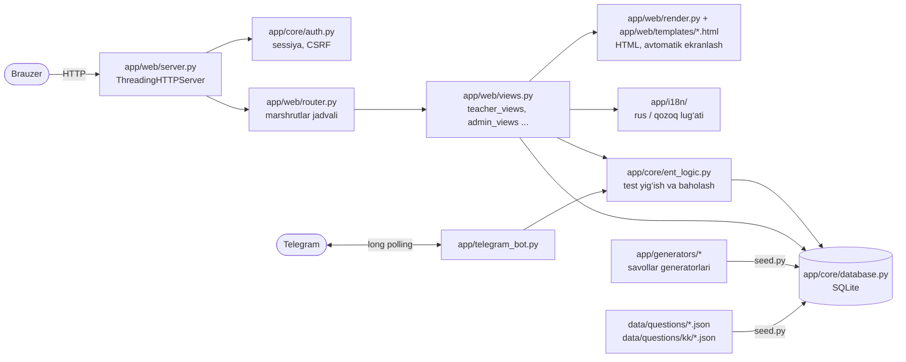

# ENT MASTER — Yagona milliy testga tayyorlanish platformasi

**ENT MASTER** — Qozog‘iston bitiruvchilarini **ENT**ga (Yagona milliy test, qozoqcha — ҰБТ) tayyorlash
uchun yaratilgan veb-sayt va Telegram-bot. Sayt rasmiy formatdagi to‘liq sinov testini (120 ta topshiriq,
140 ball, 4 soat), 16 fan bo‘yicha mashqlarni, har bir xatoning tushunarli tahlilini, o‘qituvchi kabinetini
va ikki tilli interfeysni (rus va qozoq tillari) taqdim etadi.

Loyiha butunlay **Python standart kutubxonasi, HTML va CSS** asosida yozilgan: hech qanday freymvork,
tashqi paket yoki JavaScript ishlatilmagan.

---

## Skrinshotlar

| Bosh sahifa | Sinov ENT (test jarayoni) |
|---|---|
|  |  |

| Natija | Xato tahlili |
|---|---|
|  |  |

| O‘qituvchi kabineti | Qozoq tilidagi versiya |
|---|---|
|  |  |

---

## Imkoniyatlar

### Mehmon (ro‘yxatdan o‘tmagan foydalanuvchi)
- ENT tuzilishi bilan tanishadi: 3 ta majburiy fan va tanlanadigan profil fanlar juftligi.
- Interfeys tilini tanlaydi: **РУС / ҚАЗ** (tanlov cookie’da saqlanadi).
- Elektron pochta orqali ro‘yxatdan o‘tadi (6 xonali tasdiqlash kodi bilan) yoki Google orqali kiradi.

### O‘quvchi
- **Sinov ENT** — rasmiy formatda: 120 ta topshiriq, 140 ball, 4 soat; vaqtni server hisoblaydi.
  Test davomida to‘g‘ri javoblar ko‘rsatilmaydi — xuddi haqiqiy imtihondagidek.
- **Mashq** — tanlangan fan bo‘yicha 10 ta savol; har bir javobdan so‘ng to‘g‘ri yoki noto‘g‘riligi
  va qisqa izoh darhol ko‘rinadi.
- **Natija tahlili** — fanlar bo‘yicha ballar, har bir topshiriq: o‘quvchining javobi (qizil), to‘g‘ri
  javob (yashil) va izoh.
- **Shaxsiy kabinet** — eng yaxshi va o‘rtacha ball, kuchli va zaif fanlar, ENT spetsifikatsiyasining
  zaif mavzulari, urinishlar tarixi.
- **O‘qituvchi topshiriqlari** kabinetning eng yuqorisida: nima qilish kerak, «N tadan X» progress,
  muddat va topshiriqni darhol boshlash tugmasi.
- **Bildirishnomalar** (🔔): ariza qabul qilindi yoki rad etildi, yangi topshiriq, muddatga bir kundan
  kam qoldi. Akkaunt Telegram-botga bog‘langan bo‘lsa, bildirishnoma u yerga ham keladi.
- **O‘qitish tili** (rus yoki qozoq) — savollar faqat shu tilda beriladi.

### O‘qituvchi
- Faqat o‘z ishini ko‘radi: maktabga kelgan **arizalar** (qabul qilish / rad etish), **o‘quvchilar**,
  **topshiriqlar** va **o‘z savollari**. Administrator bo‘limlari unga ko‘rinmaydi va yopiq.
- **O‘quvchilar jadvali**: oxirgi faollik; bugun, kecha va 7 kun ichidagi sinov ENT va mashqlar soni;
  oxirgi, o‘rtacha va eng yaxshi natija; o‘zgarish (o‘sish / pasayish); zaif fanlar. Istalgan ustun
  bo‘yicha saralash, davr filtri (bugun, kecha, 7 kun, 30 kun, butun vaqt). Standart tartibda yuqorida
  **yordamga muhtoj** o‘quvchilar turadi.
- **O‘quvchi kartochkasi** — kunlar bo‘yicha lenta: nima qilgani, ballari, qaysi fanlardan.
- **Topshiriqlar**: «N ta sinov ENT» (istalgan yoki aniq juftlik) yoki «N ta mashq» muddat bilan;
  kim bajargani jadvali. Faqat topshiriq berilgandan keyin va muddatgacha tugatilgan urinishlar hisobga olinadi.
- **Savollar taklif qilish**: o‘qituvchi savol qo‘shadi (tilini tanlaydi), u bosh administrator
  tekshiruvidan so‘ng umumiy bankka tushadi.

### Bosh administrator
- Savollar banki: qo‘shish, tahrirlash, o‘chirish, qidiruv, ENT normasiga ko‘ra to‘liqlik.
- O‘qituvchilar savollarini tekshirish: ma’qullash, izoh bilan rad etish yoki tuzatib ma’qullash.
- Milliy test markazi (НЦТ) spetsifikatsiyasi mavzulari bo‘yicha qamrov hisoboti — rus va qozoq banklari alohida.
- Foydalanuvchilar, maktablar, reklama bannerlari (JavaScript’siz, faqat o‘quvchilar va mehmonlarga,
  hech qachon test vaqtida emas).

### Telegram-bot
- Mashqlar tugmalar orqali, natijalar, saytga bir martalik havola orqali kirish.
- Bot bog‘langan akkaunt tilida (yoki Telegram ilovasi tilida) gapiradi.

---

## Kod qanday tuzilgan



Loyiha papkalari:

```text
run.py            sayt va botni ishga tushirish (--share — internet orqali ko‘rsatish)
seed.py           savollarni bazaga yuklash
manage_admin.py   administrator va o‘qituvchi rollarini berish
app/
  config.py       ENT formati va barcha sozlamalar
  core/           baza, test logikasi, avtorizatsiya, maktablar, bildirishnomalar
  web/            HTTP-server, marshrutlar, sahifalar, templates/ va static/
  i18n/           ikki tilli interfeys (rus / qozoq)
  generators/     savollar generatorlari
  telegram_bot.py Telegram-bot
data/questions/   savollar (JSON), kk/ — qozoqcha
server/           serverga joylash: systemd, Caddy, setup.sh, update.sh, zaxira nusxa, xabarlar, --share
tests/            avtomatik testlar
```

| Fayl | Vazifasi |
|---|---|
| `run.py` | Sayt va botni bitta buyruq bilan ishga tushiradi; `run.py site` / `run.py bot` — alohida; `--share` — internet orqali ko‘rsatish (Cloudflare Quick Tunnel). |
| `app/config.py` | ENT formatining yagona manbai: fanlar, topshiriq turlari bo‘yicha kvotalar, ballar, vaqt, juftliklar, tillar. |
| `seed.py` | JSON-savollarni tekshiradi va bazaga yuklaydi, generatorlar savollarini qo‘shadi, rus/qozoq jadvalini chiqaradi. |
| `app/web/server.py` | HTTP-server: so‘rovni tahlil qiladi, statik fayllar, xavfsizlik sarlavhalari, xatolarni chiroyli sahifaga aylantiradi. |
| `app/web/router.py` | URL → ishlovchi funksiya jadvali (`<int:id>` parametrlari bilan). |
| `app/web/views.py` | O‘quvchi sahifalari: kabinet, sinov ENT, mashq, natija, tarix, profil, bildirishnomalar. |
| `app/web/teacher_views.py` | O‘qituvchi kabineti: arizalar, o‘quvchilar jadvali, kartochka, topshiriqlar, savollar. |
| `app/web/admin_views.py` | Administrator paneli. |
| `app/web/render.py` | `string.Template` asosidagi shablonlar; har bir qiymat HTML-ekranlanadi. |
| `app/core/ent_logic.py` | Testni yig‘ish (kvotalar, aralashtirish, o‘quvchi tili), baholash, server taymeri. |
| `app/core/database.py` | Barcha SQL so‘rovlar (faqat parametrlangan), jadvallar va eski bazani yangilash (migratsiya). |
| `app/core/auth.py` | Parollar (PBKDF2), sessiyalar, CSRF, pochta kodlari, telefonni normallashtirish. |
| `app/core/notifications.py` | Bildirishnomalar va ularning Telegram’dagi nusxasi. |
| `app/core/student_stats.py` | O‘qituvchi uchun o‘quvchilar statistikasi: davrlar, o‘zgarish, zaif fanlar, kunlik lenta. |
| `app/i18n/` | Ikki tilli interfeys: rus matni — kalit, qozoqcha (`kk.py`) — qiymat; shablonlarni avtomatik tarjima qilish. |
| `app/generators/` | Hisob-kitob savollari shablonlari va faktlar jadvallaridan savollar (rus va qozoq tillarida). |
| `app/telegram_bot.py` | Telegram-bot: faqat standart kutubxona (`urllib`). |
| `data/questions/` | Savollar JSON’da; `kk/` papkasida — ularning qozoqcha tarjimasi. |
| `server/` | Serverga joylash: systemd xizmatlari, Caddy (HTTPS), `setup.sh`, `update.sh`, zaxira nusxalar (`python3 -m server.backup`), nosozlik xabarlari (`python3 -m server.notify`), `--share` tunneli. |
| `tests/` | Avtomatik testlar. |

---

## Ballar qanday hisoblanadi va test qanday yig‘iladi

ENT formati `app/config.py` da kvotalar orqali tasvirlangan — umumiy sonlar qo‘lda yozilmaydi, kvotalardan hisoblanadi:

| Bo‘lim | Topshiriqlar | Ball |
|---|---|---|
| Qozog‘iston tarixi (majburiy) | 20 ta bitta javobli | 20 |
| Matematik savodxonlik (majburiy) | 10 ta bitta javobli | 10 |
| O‘qish savodxonligi (majburiy) | 10 ta matn asosidagi | 10 |
| 1-profil fan | 25 bitta javobli + 5 kontekstli + 5 moslashtirish + 5 ko‘p javobli | 50 |
| 2-profil fan | xuddi shunday | 50 |
| **Jami** | **120** | **140** |

- Bitta javobli va kontekstli topshiriq — **1 ball**.
- Moslashtirish va ko‘p javobli topshiriq — xatosiz bo‘lsa **2 ball**, bitta xato bo‘lsa **1 ball**, aks holda 0.
- Har bir fan bo‘yicha savollar bankdan tasodifiy tanlanadi: avval o‘quvchi hali ko‘rmagan savollar.
  Savollar va javob variantlari aralashtiriladi (variantlar tartibi har bir urinish uchun saqlanadi).
- O‘quvchi faqat o‘z **o‘qitish tilidagi** savollarni oladi. «Til va adabiyot» profil juftligi o‘qitish
  tiliga bog‘liq: qozoq tilida — «Qozoq tili + Qozoq adabiyoti», rus tilida — «Rus tili + Rus adabiyoti».
- Vaqt: to‘liq test uchun 240 daqiqa; muddat serverda saqlanadi, vaqt tugaganda test avtomatik yakunlanadi.
- Bankda savol yetishmasa, test mavjud savollardan, vaqtni mutanosib qisqartirgan holda yig‘iladi va bu ochiq ko‘rsatiladi.

---

## Xavfsizlik

- **Parollar** faqat xesh ko‘rinishida saqlanadi: PBKDF2-SHA256, har bir foydalanuvchi uchun alohida «tuz».
- **Sessiya** cookie’sida tasodifiy token; bazada faqat uning SHA-256 xeshi. Cookie — `HttpOnly`, `SameSite=Lax`
  (HTTPS serverda — `Secure`).
- **CSRF**: tizimga kirgan foydalanuvchining har bir POST-formasi sessiya tokeni bilan tekshiriladi.
- **CSP** (Content-Security-Policy) har qanday skriptni va tashqi resurslarni taqiqlaydi; saytda JavaScript yo‘q.
- **SQL in’ektsiyalardan himoya**: barcha so‘rovlar faqat parametrlangan.
- **XSS’dan himoya**: shablonlarga qo‘yiladigan har bir qiymat HTML-ekranlanadi.
- Kirish huquqlari har bir so‘rovda tekshiriladi: o‘qituvchi faqat o‘z maktabini, o‘quvchi faqat o‘z urinishlarini ko‘radi.
- Elektron pochta kodlari va Telegram orqali kirish havolalari bir martalik, muddatli; bazada faqat xeshi saqlanadi.
- Maxfiy kalitlar (Telegram tokeni, SMTP, Google) faqat `.env` faylida — u git’ga tushmaydi.

---

## Texnologiyalar

- **Python 3.11+**, faqat standart kutubxona: `http.server`, `sqlite3`, `hashlib`, `hmac`, `secrets`,
  `string.Template`, `urllib`, `smtplib`, `email`, `contextvars`, `unittest` va boshqalar.
- **SQLite** — ma’lumotlar bazasi.
- **HTML + CSS** — interfeys (moslashuvchan dizayn, yorug‘ va qorong‘i mavzu), **JavaScript’siz**.
- Freymvorklar ham, `pip install` ham kerak emas.

---

## Ishga tushirish (3 ta buyruq)

```bash
git clone https://github.com/isamatovismail-svg/ENT_MASTER.git && cd ENT_MASTER
python3 seed.py        # savollarni bazaga yuklash (rus va qozoq tillarida)
python3 run.py         # sayt (va .env da token bo‘lsa — Telegram-bot)
```

So‘ng brauzerda **http://localhost:8000** manzilini oching.

Telegram-bot, pochta (SMTP) va Google orqali kirish ixtiyoriy: `.env.example` faylini `.env` ga nusxalab,
kalitlarni yozing.

### Saytni internet orqali ko‘rsatish (bepul, akkauntsiz)

```bash
python3 run.py --share
```

Sayt, bot va **Cloudflare Quick Tunnel** ishga tushadi; terminalda `https://….trycloudflare.com` ko‘rinishidagi
vaqtinchalik ommaviy havola katta qilib chiqadi — uni o‘qituvchiga yuboring. Ko‘rsatishni o‘chirish uchun
terminalda **Ctrl+C** bosing: sayt, bot va tunnel birga to‘xtaydi. Buning uchun bir marta Cloudflare’ning
rasmiy `cloudflared` paketini o‘rnatish kerak.

Doimiy serverga joylash (Ubuntu, systemd, Caddy orqali HTTPS, zaxira nusxalar) — `server/` papkasida.

---

## Testlar

```bash
python3 -m unittest            # barcha testlar (190 ga yaqin)
python3 -m unittest -v tests.test_languages
```

Testlar har birida alohida vaqtinchalik bazadan foydalanadi, haqiqiy serverni ishga tushirib sahifalarni
«brauzer» kabi tekshiradi, Telegram va pochtaga hech narsa yubormaydi. Ular quyidagilarni tekshiradi:
baholash qoidalari, testni yig‘ish, har bir juftlik va har bir til uchun to‘liq 120 ta topshiriqli test,
kirish huquqlari, CSRF, o‘qituvchi kabineti, bildirishnomalar, qozoqcha sahifalarda ruscha matn
qolmaganligi, qozoqcha tarjimada javoblar, raqamlar va formulalar o‘zgarmaganligi.

---

## Кратко на русском

**ENT MASTER** — сайт и Telegram-бот для подготовки к ЕНТ: пробный тест в официальном формате,
тренировки, разбор ошибок, кабинет учителя, русский и казахский языки — только Python, HTML и CSS.
